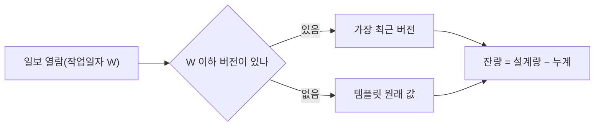

::: abstract
작업일보 화면에서 공정 설계량을 5에서 10으로 고쳐 저장한 뒤 전에 열어 본 다음 날짜로 이동하면 5가 보였고, 날짜를 몇 번 더 옮겨야 10이 나왔다. 서버의 [[effective-dated|적용일 기준 버전]] 계산은 시나리오 테스트 8개를 통과했고 원인이 아니었다.
원인은 프론트엔드에서 두 동작이 겹친 것이다. TanStack Query 는 캐시의 옛 값(5)을 먼저 주고 백그라운드 요청이 끝나면 새 값(10)을 준다. 설계량 열을 채우는 [[overlay|오버레이]]는 (현장, 날짜) 키당 한 번만 실행되도록 막혀 있어서, 옛 값으로 한 번 실행한 뒤 새 값을 건너뛰었다.
키 게이트를 없애고 데이터가 바뀔 때마다 다시 적용하되, 사용자가 고친 행은 건너뛰고 바뀐 행이 없으면 원본을 돌려주도록 고쳤다. 타입 검사와 린트, 관련 테스트 145개(회귀 테스트 2개 추가)가 통과했다.
:::

## 1. 배경

### 1.1 대상 기능

[[domain:jakeopilbo|작업일보]]는 건설 현장의 하루 작업 기록이다. 화면의 공정 표는 공정마다 [[domain:gongjeong|설계량]](계획된 전체 물량), 누계, 잔량을 보여 주고, 잔량은 `설계량 − 누계` 로 계산한다.

설계량은 현장 여건에 따라 바뀐다. 작업일보는 정산과 감사의 근거라서, 오늘 설계량을 바꿔도 과거 날짜의 일보는 예전 설계량으로 계산되어야 한다([[domain:why-design|요구 배경]]). 그래서 설계량을 날짜별 버전으로 저장하는 [[effective-dated|적용일 기준 버전]] 방식으로 구현했다.



- **백엔드**: `process_design_versions` 테이블에 `(공정, effective_from, 값)` 을 저장한다. 작업일자 W 의 일보를 열면 `resolve_effective_design` 이 W 이하에서 가장 최근 버전을 고른다. 버전이 하나도 없으면 템플릿의 원래 설계량을 쓰므로 기존 데이터의 결과는 바뀌지 않는다.
- **프론트엔드**: `useProcessDesign(project, date)` 훅이 그날 유효한 설계량을 TanStack Query 로 가져온다([[stale-time|staleTime]] 30초). 저장된 일보는 서버 상세 데이터로 표를 채우고, 새 일보나 빈 날짜는 오버레이가 표의 설계량 열을 그날 유효한 값으로 채운다.

### 1.2 문제 상황

사용자 보고는 다음과 같았다.

> 설계량을 수정하고 바로 다음 날로 넘어갔는데 반영이 늦다. 날짜를 몇 번 옮겨야 그제서야 반영된다. 당일 수정한 날은 바로 반영된다.

<figure class="post-video">
<video controls preload="metadata" playsinline src="/post-assets/work/analysis/cache-overlay-timing-rca/symptom.mp4">
이 브라우저는 video 태그를 지원하지 않습니다. <a href="/post-assets/work/analysis/cache-overlay-timing-rca/symptom.mp4" target="_blank" rel="noopener">영상 새 창에서 열기</a>
</video>
<figcaption>증상 재현. 설계량을 수정해 저장한 뒤 다음 날짜로 이동하면 옛 값이 보이고, 날짜를 몇 번 옮긴 뒤에 새 값이 나온다.</figcaption>
</figure>

| 조건 | 결과 |
| --- | --- |
| 설계량을 고친 당일 | 즉시 반영 |
| 저장 후 처음 여는 날짜 | 즉시 반영 |
| 저장 후 이전에 방문한 적 있는 날짜 | 옛 값, 날짜를 몇 번 옮긴 뒤 반영 |

당일이 정상이라는 점은 편집한 값을 담는 화면 상태에는 문제가 없다는 뜻이다. 이전에 방문한 날짜에서만 생긴다는 점은 캐시에 데이터가 남아 있는 경우와 관련이 있다는 뜻이다.

### 1.3 목표와 제약

- 저장한 설계량이 날짜를 옮긴 직후 그 날짜의 유효 값으로 화면에 나와야 한다.
- 사용자가 화면에서 직접 고친 행은 서버 값으로 덮지 않는다.
- 서버의 버전 계산과 API 는 바꾸지 않는다. 시나리오 테스트 S1~S8 이 통과한 상태다.

---

## 2. 방법

### 2.1 데이터 경로 분리

설계량이 화면에 들어오는 경로를 세 개로 나눠 하나씩 확인했다.

| 경로 | 내용 | 당일 | 다른 날짜 |
| --- | --- | --- | --- |
| 로컬 편집 값 | 편집한 값이 화면 상태에 그대로 남는다 | 사용 | 사용 안 함 |
| 서버 유효 값 조회 | `useProcessDesign` 이 그날 값을 가져온다 | 사용 | 사용 |
| 오버레이 적용 | 받은 값으로 표의 설계량 열을 채운다 | 사용 | 사용 |

1.2절의 대조 결과로 첫 번째 경로는 제외했다. 남은 두 경로를 가설로 세웠다.

### 2.2 가설과 확인 방법

| 가설 | 확인 방법 | 결과 |
| --- | --- | --- |
| (a) 저장 후 [[invalidate|무효화]]하는 쿼리 키가 틀려서 다른 날짜 캐시가 stale 이 되지 않는다 | 무효화 호출의 키와 쿼리 키 비교 | 기각 |
| (b) 새 값은 도착하지만 오버레이가 다시 실행되지 않는다 | 오버레이 `useEffect` 의 실행 조건 확인 | 채택 |

(a) 는 기각했다. 무효화는 쿼리 키의 앞부분으로 일치하는 쿼리를 모두 찾는다<a href="https://tanstack.com/query/latest/docs/framework/react/guides/query-invalidation" target="_blank"><sup>[3]</sup></a>. 저장 후 호출은 날짜를 뺀 앞부분 키를 넘기므로 그 현장의 모든 날짜 쿼리가 stale 이 된다.

### 2.3 오버레이 구현 (수정 전)

```ts
useEffect(() => {
  // ... 데이터 로딩, 저장된 일보 여부 같은 가드 ...
  const token = `${project}:${date}`;
  if (designOverlaidRef.current === token) return; // (현장, 날짜)당 한 번만 실행
  designOverlaidRef.current = token;
  setProcessRows((prev) => applyProcessDesignOverlay(prev, getEffectiveDesign));
}, [project, date, designMap /* ... */]);
```

의존성 배열에 `designMap` 이 있어서 데이터가 바뀌면 이 effect 는 다시 실행된다. 하지만 같은 (현장, 날짜) 에서 두 번째 실행은 `token` 비교에서 바로 끝난다.

---

## 3. 결과

### 3.1 원인: 옛 값이 먼저 오고 게이트가 닫힌다

TanStack Query 는 캐시에 데이터가 있는 쿼리를 다시 구독하면 그 데이터를 바로 돌려주고, 쿼리 함수는 백그라운드에서 실행한다. 요청이 끝나면 캐시를 새 데이터로 바꾼다<a href="https://tanstack.com/query/latest/docs/framework/react/guides/caching" target="_blank"><sup>[1]</sup></a>.
stale 상태의 쿼리는 새 인스턴스가 마운트될 때 자동으로 다시 요청된다<a href="https://tanstack.com/query/latest/docs/framework/react/guides/important-defaults" target="_blank"><sup>[2]</sup></a>. 이것이 [[stale-while-revalidate]] 동작이다.

D일에 설계량을 5에서 10으로 저장하고, 전에 방문한 D+1 로 옮기면 다음 순서로 실행된다.

```seq
title: D+1 로 이동한 뒤 오버레이가 받는 값
speed: 1700
caption: 옛 값 5로 키를 기록한 뒤 도착한 10은 건너뛴다.

lane rq      TanStack Query 캐시
lane gate    오버레이 키 기록
lane screen  화면 설계량 #log

step D일에 5 → 10 으로 저장한다. 서버에 effective_from=D 버전이 생기고, 설계량 쿼리가 모두 stale 이 된다.
  push rq D+1: 5 (stale)
step D+1 로 이동한다. 캐시에 남은 5를 바로 돌려주고 백그라운드 요청을 시작한다.
  log screen 요청 시작, 응답 대기
step 오버레이가 5로 설계량 열을 채우고 키 site:D+1 을 기록한다.
  push gate site:D+1
  log screen 5
step 요청이 끝나 캐시가 10으로 바뀐다. designMap 이 바뀌어 effect 가 다시 실행된다.
  pop rq
  push rq D+1: 10
step 키 site:D+1 이 이미 기록되어 있어 effect 가 바로 끝난다. 화면은 5로 남는다.
  mark gate
  log screen 5 (10 건너뜀)
step 다른 날짜로 갔다 돌아오면 키가 바뀌어 다시 실행된다. 이때 캐시에 10이 있어 그제야 반영된다.
  log screen 10
```

| 시점 | `designMap` | 오버레이 |
| --- | --- | --- |
| 이동 직후 | 캐시의 옛 값 5 | 키가 기록되어 있지 않아 실행, 화면 5, 키 기록 |
| 요청 완료 | 새 값 10 | effect 재실행, 키가 이미 있어 종료, 화면 5 유지 |

::: danger
**근본 원인**: 「키당 한 번만 적용」하는 게이트를, 한 키 안에서 값이 옛 값에서 새 값으로 바뀌는 비동기 캐시 데이터에 적용했다. 게이트는 키만 보고 데이터가 바뀌었는지는 보지 않으므로, 첫 값이 옛 값이면 새 값을 받지 못한다.
:::

「날짜를 몇 번 옮겨야 반영된다」는 증상은 이 순서로 설명된다. 다른 날짜로 갔다 돌아오면 `designOverlaidRef` 에 다른 키가 기록되어 있으므로 게이트가 열리고, 이때 캐시에는 이미 10이 있다.

### 3.2 재현 시뮬레이션

아래 코드는 캐시가 옛 값 5를 바로 주고 120 ms 뒤 새 값 10을 주는 상황을 만들고, 수정 전 게이트와 수정 후 방식을 차례로 실행한다. 실행하면 콘솔에 각 시점의 화면 값이 찍힌다.

```playground
#! js title=overlay-timing.js
// 캐시는 옛 값(5)을 바로 주고, 120ms 뒤 백그라운드 refetch 가 새 값(10)을 준다.
function subscribeDesign(onData) {
  onData({ design: 5, from: "캐시(stale)" });
  setTimeout(() => onData({ design: 10, from: "refetch" }), 120);
}

const KEY = "site-1:2026-07-16";

// 수정 전: (현장, 날짜) 키당 한 번만 적용
function overlayOncePerKey() {
  let rows = [{ name: "강관말뚝", design: null }];
  let appliedKey = null;
  subscribeDesign(({ design, from }) => {
    if (appliedKey === KEY) {
      console.log("[수정 전]", from, design, "도착, 이미 적용한 키라 건너뜀");
      return;
    }
    appliedKey = KEY;
    rows = rows.map((r) => ({ ...r, design }));
    console.log("[수정 전]", from, design, "도착, 화면", rows[0].design);
  });
  setTimeout(() => console.log("[수정 전] 최종 화면:", rows[0].design), 200);
}

// 수정 후: 데이터가 바뀔 때마다 적용, 사용자가 고친 행은 건너뜀
function applyOverlay(prev, design) {
  let changed = false;
  const next = prev.map((r) => {
    if (r.edited || r.design === design) return r;
    changed = true;
    return { ...r, design };
  });
  return changed ? next : prev; // 바뀐 행이 없으면 원본을 그대로 돌려준다
}

function overlayDataDriven() {
  let rows = [
    { name: "강관말뚝", design: null, edited: false },
    { name: "두부정리", design: 7, edited: true },
  ];
  subscribeDesign(({ design, from }) => {
    const next = applyOverlay(rows, design);
    console.log("[수정 후]", from, design, "도착,", next === rows ? "변경 없음" : "화면 " + next.map((r) => r.design).join(", "));
    rows = next;
  });
  setTimeout(() => console.log("[수정 후] 최종 화면:", rows.map((r) => r.name + " " + r.design).join(", ")), 200);
}

overlayOncePerKey();
setTimeout(overlayDataDriven, 300);
```

Node.js 로 실행한 출력은 다음과 같다. 두부정리 행은 사용자가 7로 고친 행이라 두 번 모두 그대로다.

```text
[수정 전] 캐시(stale) 5 도착, 화면 5
[수정 전] refetch 10 도착, 이미 적용한 키라 건너뜀
[수정 전] 최종 화면: 5
[수정 후] 캐시(stale) 5 도착, 화면 5, 7
[수정 후] refetch 10 도착, 화면 10, 7
[수정 후] 최종 화면: 강관말뚝 10, 두부정리 7
```

### 3.3 수정


키 게이트를 지우기만 하면 다른 문제가 생긴다. 게이트는 같은 키에서 오버레이를 한 번만 실행하게 막으면서, 결과적으로 사용자가 편집한 행을 다시 덮지 않게 하는 역할도 하고 있었다. 게이트를 지우면 refetch 가 끝날 때마다 사용자가 방금 입력한 값이 서버 값으로 바뀐다. 그래서 두 역할을 나눴다.

1. **키 게이트 제거**: `designMap` 이 바뀔 때마다 오버레이를 다시 실행한다.
2. **편집 행 가드**: `isEdited` 로 사용자가 고친 행은 건너뛴다.
3. **변경 없음 처리**: 바뀐 행이 없으면 이전 배열을 그대로 돌려줘 React 가 다시 렌더하지 않게 한다. 같은 데이터로 여러 번 실행해도 결과가 같은 [[idempotent|멱등]] 함수가 된다.

```ts
setProcessRows((prev) => {
  const next = applyProcessDesignOverlay(prev, getEffectiveDesign, isEdited); // 편집 행은 건너뜀
  if (next === prev) return prev; // 바뀐 행이 없으면 상태를 바꾸지 않는다
  return next; // 값이 바뀐 미편집 행만 새 유효 값으로 바뀐다
});
```

### 3.4 검증

| 항목 | 결과 |
| --- | --- |
| `tsc` 타입 검사 | 통과 |
| `eslint` | 통과 |
| 관련 테스트 | 145개 통과 |
| 추가한 회귀 테스트 | 「편집 행 보존」, 「변경 없을 때 원본 반환」 2개 |

---

## 4. 논의

### 4.1 검토한 대안

| 대안 | 판단 |
| --- | --- |
| 저장 응답으로 `setQueryData` 를 호출해 캐시를 바로 갱신<a href="https://tanstack.com/query/latest/docs/framework/react/guides/updates-from-mutation-responses" target="_blank"><sup>[4]</sup></a> | 응답으로 바로 바꿀 수 있는 것은 저장한 날짜의 캐시다. 이후 날짜의 유효 값은 서버가 버전을 골라 계산하고, 편집 중인 행과 합치는 처리도 따로 필요하다. 무효화 후 멱등 재적용이 더 단순해 채택하지 않았다. |
| 게이트 키에 데이터 버전(`updatedAt` 등)을 넣기 | 새 데이터가 오면 키가 바뀌어 게이트가 열린다. 게이트를 유지해야 하는 이유가 없어 단순한 쪽을 택했다. |
| `staleTime` 을 0으로 낮추기 | 이 문제와 관계없다. 무효화한 쿼리는 `staleTime` 설정과 상관없이 stale 이 된다<a href="https://tanstack.com/query/latest/docs/framework/react/guides/query-invalidation" target="_blank"><sup>[3]</sup></a>. |
| 게이트 제거 + 편집 행 가드 + 변경 없음 처리 | 채택. 서버 값을 기준으로 두고 사용자 편집만 따로 보존한다. |

### 4.2 원인이 구현과 리뷰에서 걸리지 않은 이유

이 기능은 AI 에이전트 파이프라인(설계 → 백엔드 → 프론트엔드 → 리뷰)으로 만들었다. 설계 문서는 「그날 유효한 설계량을 화면에 채운다」까지만 정했고, 몇 번 채울지는 프론트엔드 구현 에이전트가 정했다.

| 항목 | 설계 의도 | 구현 | 차이 |
| --- | --- | --- | --- |
| 적용 시점 | 그날 유효 값을 반영 (횟수 미정) | (현장, 날짜)당 1회 | 같은 키 안에서 값이 바뀔 수 있다는 점을 반영하지 않음 |
| 편집 보호 | 사용자 편집 행은 덮지 않음 | 1회 실행이 간접적으로 보호 | 두 역할이 한 장치에 들어감 |
| 최신성 | 항상 그날 유효 값 | 첫 데이터로 고정 | stale 에서 fresh 로 바뀌는 캐시 동작과 충돌 |

- **기존 패턴 복제**: 구현 에이전트는 같은 화면의 「금일 진도 오버레이」가 쓰는 (현장, 날짜) 키 게이트를 그대로 가져왔다. 금일 진도는 사용자가 입력하는 값이라 한 번 채우면 충분했다. 설계량은 저장 후 서버에서 다시 받는 값이라 조건이 달랐다.
- **정적 검사 통과**: 타입 검사, 린트, 단위 테스트가 모두 통과했다. 이 문제는 옛 값과 새 값이 시간차를 두고 도착할 때만 생겨서 정적 검사로는 드러나지 않는다.
- **리뷰에서 정당해 보임**: 게이트가 편집 보호도 하고 있어서 AI 리뷰어는 1회 실행을 합리적인 선택으로 읽었다.

이번 작업에서 구조로 검증할 수 있는 부분(데이터 모델, 버전 선택 로직, 타입)은 AI 에이전트가 정확히 만들었다. 시간 순서에 따라 결과가 달라지는 부분(캐시 갱신 순서, effect 재실행 조건)에서 문제가 났다. 리뷰할 때 확인할 항목은 다음과 같다.

- [ ] 비동기 캐시 데이터에 「한 번만 실행」 조건이 있으면, 옛 값이 먼저 오고 새 값이 나중에 오는 순서에서도 새 값이 반영되는지 확인한다
- [ ] 기존 패턴을 가져다 쓰면, 원본 데이터와 새 데이터의 갱신 방식(로컬 입력인지 서버 재요청인지)이 같은지 확인한다
- [ ] 한 장치가 두 가지 역할을 하고 있으면 나눈다
- [ ] 「저장 → 다른 날짜 → 옛 캐시 → refetch 후 새 값」 순서를 테스트 시나리오로 적는다
- [ ] 사용자 보고의 대조 조건(당일 정상, 방문했던 날짜만 문제)을 원인 추적의 첫 단서로 쓴다

### 4.3 한계

- 추가한 회귀 테스트 2개는 오버레이 함수 단위 테스트다. 이 글에 기록된 검증에는 날짜 이동, 옛 캐시 반환, refetch 완료 순서를 실제 훅과 함께 재현하는 통합 테스트가 없다.
- 3.2절 시뮬레이션은 refetch 지연을 120 ms 로 고정했다. 실제 지연은 네트워크에 따라 다르지만, 옛 값이 먼저 오는 순서는 같다.

---

## 5. 결론

- 서버의 적용일 기준 버전 계산은 정확했고, 문제는 프론트엔드 오버레이의 실행 조건에 있었다.
- TanStack Query 는 캐시의 옛 값을 먼저 주고 백그라운드 요청이 끝나면 새 값을 준다. 키당 1회 게이트는 옛 값으로 실행된 뒤 새 값을 건너뛰었다.
- 게이트를 없애고 데이터가 바뀔 때마다 다시 적용하되, 편집 행 가드와 변경 없음 처리를 따로 두어 해결했다. 테스트 145개가 통과했다.
- 값이 나중에 바뀔 수 있는 비동기 데이터에는 「키당 한 번」이 아니라 「데이터가 바뀔 때마다 멱등하게 적용」을 쓴다. 게이트가 꼭 필요하면 키에 데이터 버전을 넣는다.

---

## 부록 A. 진행 기록

| 단계 | 내용 |
| --- | --- |
| 요청 | 설계량을 적용일 기준 버전으로 저장, 이후 「다음 날짜 반영 지연」 원인 규명 |
| 구현 상태 | `useProcessDesign` (TanStack Query, staleTime 30초) + (현장, 날짜)당 1회 오버레이 |
| 증상 | 저장 후 이전에 방문한 날짜로 이동하면 옛 설계량, 날짜를 몇 번 옮긴 뒤 반영 |
| 기각한 가설 | 무효화 쿼리 키 오류 (앞부분 일치로 모든 날짜가 stale 처리됨) |
| 근본 원인 | stale-while-revalidate 와 키당 1회 게이트의 충돌 |
| 수정 | 게이트 제거, `isEdited` 편집 행 가드, 변경 없을 때 원본 반환 |
| 검증 | tsc, eslint 통과, 테스트 145개 통과 (회귀 2개 추가) |

## 참고

<ol>
<li><a href="https://tanstack.com/query/latest/docs/framework/react/guides/caching" target="_blank">[1] Caching Examples — TanStack Query</a></li>
<li><a href="https://tanstack.com/query/latest/docs/framework/react/guides/important-defaults" target="_blank">[2] Important Defaults — TanStack Query</a></li>
<li><a href="https://tanstack.com/query/latest/docs/framework/react/guides/query-invalidation" target="_blank">[3] Query Invalidation — TanStack Query</a></li>
<li><a href="https://tanstack.com/query/latest/docs/framework/react/guides/updates-from-mutation-responses" target="_blank">[4] Updates from Mutation Responses — TanStack Query</a></li>
</ol>

---

## 관련 글

- [React 단방향 데이터 흐름 →](/post/react-component-data-flow) (서버 값과 로컬 상태를 어디에 둘지)
- [3D 캔버스 렌더 최적화 8가지를 하나씩 켜서 잰 결과 →](/post/modeler-canvas-render-ablation) (같은 work 시리즈)
- [QA 브라우저 자동화를 서브에이전트로 분리할 때의 토큰 비용 모델 →](/post/ai-agent-qa-automation-token-economics) (AI 에이전트로 QA 를 돌릴 때의 비용 분석)

<!-- 도메인 배경 카드: 본문에는 보이지 않고, 본문 링크를 누르면 모달로 열린다 -->

::: domain id="jakeopilbo" title="작업일보란?"
건설 현장에서 **하루 단위로 그날 한 일을 기록하는 문서**다. 이 시스템은 종이 일보를 웹으로 옮겼다. 하루치 한 장에는 다음 항목이 들어간다.

- **결재란**: 담당, 현장소장, 부서장
- **공사명, 작업일자, 날씨**
- **금일작업, 명일작업**: 오늘 한 일과 내일 할 일
- **특이사항**: 안전, 민원, 기상
- **① 공정 진도**: 이 글에서 다루는 표
- **② 인원, ③ 장비, ④ 자재 투입현황**

작업일보는 그 시점의 기록이라 정산과 감사의 근거가 된다. 과거 문서에 표시된 숫자가 나중에 바뀌면 안 된다.
:::

::: domain id="gongjeong" title="공정 진도 표와 설계량"
공정은 「말뚝박기」, 「두부정리」 같은 **작업 종류**다. 공정마다 진행 상황을 표로 관리한다.

| 용어 | 뜻 | 예시 |
| --- | --- | --- |
| **설계량** | 그 공정에서 해야 하는 전체 물량 | 강관말뚝 **639본** |
| **전일** | 어제까지 누적한 양 | 200본 |
| **금일** | 오늘 한 양 | 30본 |
| **누계** | 전일 + 금일 | 230본 |
| **잔량** | 설계량 − 누계 | 409본 |

잔량은 설계량을 기준으로 계산하므로, 설계량이 언제 어떤 값이었는지가 잔량을 정한다.
:::

::: domain id="why-design" title="설계량을 날짜별 버전으로 저장하는 이유"
설계량은 설계 변경, 실측 결과, 공법 변경으로 바뀔 수 있다. 예를 들어 5본이던 것이 10본으로 늘어난다.

작업일보는 그 시점의 기록이므로 요구는 다음과 같다.

> 오늘 설계량을 5에서 10으로 바꾸면, 과거 일보의 잔량은 5 기준 그대로 두고 오늘과 이후 일보만 10 기준으로 계산한다.

설계량을 값 하나로 두면 바꾸는 순간 과거 일보의 잔량까지 모두 다시 계산된다. 그래서 적용 시작일이 붙은 버전으로 저장하고, 일보를 열 때 그 날짜 이하에서 가장 최근 버전을 고른다. 각 일보가 값을 따로 저장하지 않으므로, 이미 저장된 이후 날짜의 일보도 다시 열면 새 값이 나온다.
:::
